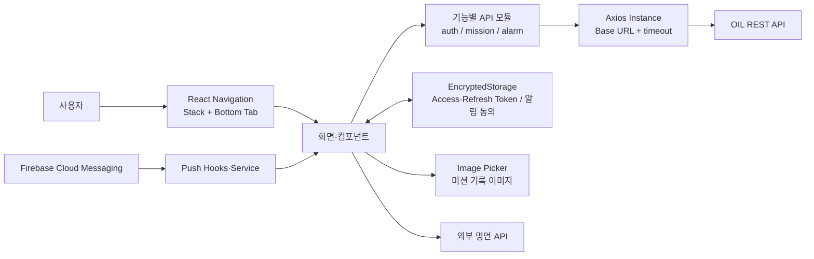

# OIL

> 매일 하나의 미션을 수행하고, 오늘의 경험을 텍스트와 이미지로 기록하는 모바일 서비스

[](https://reactnative.dev/)
[](https://www.typescriptlang.org/)
[](https://firebase.google.com/docs/cloud-messaging)

- 개발 기간: 2025.11.01 ~ 2025.12.17
- 개발 인원: 2명
- 성과: SCSC(서울대 컴퓨터 연구회) 고등학생 온라인 해커톤 최종 4위
- 저장소: [React Native 클라이언트](https://github.com/team-OIL/OIL-RN) · [백엔드](https://github.com/team-OIL/OIL-BE)

## 서비스 소개

OIL은 반복되는 일상에 작은 변화를 만드는 일일 미션 서비스입니다. 사용자는 원하는 시간에 오늘의 미션을 받고, 제한 시간 동안 미션을 수행한 뒤 텍스트와 사진으로 경험을 남길 수 있습니다. 완료한 미션과 기록은 다시 열어보며 자신의 변화를 확인할 수 있습니다.

### 주요 기능

| 기능 | 설명 |
| --- | --- |
| 회원가입·로그인 | 이메일 기반 인증과 알림 수신 여부, 미션 수신 시간, 닉네임을 설정합니다. |
| 오늘의 미션 | 서버에서 오늘의 미션을 조회하고 타이머와 함께 수행합니다. |
| 수행 기록 | 미션 결과를 텍스트와 이미지로 작성해 완료 처리합니다. |
| 완료 이력 | 완료한 미션 목록과 각 미션의 기록·완료 시점을 조회합니다. |
| 알림 | 미션 수신 시간과 알림 허용 여부를 변경하고 FCM 푸시를 처리합니다. |

## 담당 역할과 팀 구성

| 구성원 | 역할 | 담당 범위 |
| --- | --- | --- |
| [정명우 (tccmw)](https://github.com/tccmw) | Frontend | React Native 앱 구조와 UI/UX, 인증, 미션 수행·기록·이력, REST API 연동, FCM 알림 |
| [hefxpzwk](https://github.com/hefxpzwk) | Backend | 인증·사용자·미션·알림 REST API와 서버 비즈니스 로직 |

프론트엔드에서는 화면 퍼블리싱에 그치지 않고 회원가입부터 미션 수행, 기록 작성, 완료 이력 조회까지 이어지는 모바일 사용자 흐름 전체를 설계하고 구현했습니다.

## 기술 스택과 선정 이유

| 분류 | 기술 | 선정 이유 |
| --- | --- | --- |
| App | React Native, React | 하나의 코드베이스로 Android와 iOS 네이티브 기능을 사용하고 빠르게 MVP를 구현하기 위해 선택했습니다. |
| Language | TypeScript | 화면 간 파라미터와 API 응답 형식을 명시해 런타임 오류를 줄이기 위해 사용했습니다. |
| Navigation | React Navigation | 인증 흐름은 Stack, 핵심 화면은 Bottom Tab으로 분리해 화면 구조와 이동 책임을 명확히 했습니다. |
| HTTP | Axios, React Native Config | 공통 Base URL·timeout을 한 곳에서 관리하고 실행 환경별 API 주소를 코드와 분리했습니다. |
| Storage | React Native Encrypted Storage | Access Token과 Refresh Token 등 인증 정보를 일반 저장소가 아닌 암호화 저장소에 보관했습니다. |
| Push | Firebase Cloud Messaging | 로그인 시 조건부 디바이스 토큰 등록과 포그라운드·알림 진입 상태의 메시지 처리를 구현하기 위해 사용했습니다. |
| Media | React Native Image Picker | 미션 수행 결과를 기기 갤러리에서 선택하고 기록 화면에서 바로 확인할 수 있도록 사용했습니다. |
| UI | React Native SVG, Reanimated | 미션 진행도와 상태 변화를 모바일 화면에서 직관적으로 표현하기 위해 사용했습니다. |

## 주요 문제와 해결 방법

### 1. 키보드와 복합 입력으로 끊기는 모바일 흐름

- 문제: 회원가입, 시간 설정, 기록 작성 화면에서 키보드가 입력 영역을 가리고 여러 화면을 오가며 사용 맥락이 끊길 수 있었습니다.
- 해결: `KeyboardAwareScrollView` 기반 공통 `DismissKeyboardView`를 만들고, 휠 형태의 시간 선택 컴포넌트와 Stack/Bottom Tab 내비게이션을 조합했습니다.
- 결과: 입력 중에도 현재 화면과 다음 행동을 확인할 수 있고, 인증부터 미션 기록까지 일관된 이동 흐름을 유지했습니다.

### 2. 인증 정보 보호와 반복되는 API 연동

- 문제: 토큰을 일반 저장소에 보관하면 노출 위험이 있고, 화면마다 URL·timeout·인증 헤더를 직접 관리하면 통신 코드가 복잡해집니다.
- 해결: 로그인 응답의 토큰을 `EncryptedStorage`에 저장하고, 환경 변수 기반 Axios 인스턴스와 기능별 API 모듈을 분리했습니다. 인증 요청은 저장된 Access Token을 읽어 Bearer 헤더로 전달합니다.
- 결과: 화면 로직과 서버 통신 책임을 분리하고, 인증이 필요한 미션·알림 API의 호출 방식을 일관되게 유지했습니다.

### 3. 미션 수행부터 회고까지 분리된 상태

- 문제: 미션 수행, 텍스트·이미지 작성, 완료 처리, 이력 조회가 분리되면 사용자가 자신의 결과를 추적하기 어렵습니다.
- 해결: 오늘의 미션과 타이머를 연결하고, 완료 모달에서 텍스트와 이미지를 받은 뒤 완료 API를 호출했습니다. 완료 목록과 상세 기록 API를 연결해 과거 결과를 다시 확인할 수 있게 했습니다.
- 결과: **미션 조회 → 수행 → 기록 → 완료 → 회고**가 하나의 사용자 흐름으로 이어졌습니다.

### 4. 앱 상태와 사용자 동의를 고려한 푸시 알림

- 문제: 로그인 시 알림 동의와 OS 권한을 확인해야 하고, 실행 중 수신과 알림을 눌러 진입한 경우의 처리가 달랐습니다.
- 해결: 로그인 성공 후 로컬 알림 동의와 OS 권한이 모두 있을 때만 FCM 토큰을 발급해 서버에 등록했습니다. 포그라운드 메시지는 알림창으로 표시하고, 백그라운드 또는 종료 상태에서 알림을 눌러 진입하면 Navigation Ref를 통해 홈 화면으로 이동하도록 구성했습니다.
- 결과: 로그인, 푸시 수신, 알림 진입으로 이어지는 현재 앱의 실행 경로를 연결했습니다.

## 아키텍처와 데이터 흐름

아래 다이어그램은 앱의 구성을 레이어 단위로 단순화한 개요이며, 실제 호출 순서는 이어지는 데이터 흐름 설명을 기준으로 합니다.



현재 `main` 브랜치의 실제 데이터 흐름은 다음과 같습니다.

1. **로그인**: `SignIn`이 로그인 API를 호출하고 Access Token, Refresh Token, 닉네임을 `EncryptedStorage.auth`에 저장합니다.
2. **푸시 토큰 등록**: 로그인 직후 `getFcmToken`이 `EncryptedStorage.alarm`의 동의 여부와 OS 권한을 확인합니다. 조건을 만족하면 FCM 토큰을 받아 Push Token API로 서버에 등록합니다.
3. **오늘의 미션**: `BottomTabNavigator`가 저장된 Access Token으로 오늘의 미션을 조회하고, 응답을 `MainPage`와 `TaskPage`에 props로 전달합니다.
4. **미션 완료 기록**: `MainPage`의 로컬 타이머가 완료 상태를 만들면 기록 모달이 텍스트와 기기 이미지 URI를 받습니다. 모달은 저장된 `auth`와 `missions` 값을 읽어 완료 API를 호출합니다.
5. **완료 이력**: `MainPage`와 `TaskPage`가 완료 목록 API를 호출하고, 항목 선택 시 상세 API의 응답을 기록 모달에 표시합니다.
6. **명언**: `MainPage`와 `MyPage`가 Advice API 모듈을 호출합니다. 이 모듈은 공통 Axios 인스턴스에 외부 API의 절대 URL을 전달합니다.
7. **푸시 수신**: 포그라운드 메시지는 `useForegroundPush`가 알림창으로 표시합니다. 백그라운드 또는 종료 상태에서 연 알림은 `App.tsx`가 받아 Navigation Ref로 홈 화면에 연결합니다.
8. **알림 변경**: `ChangeAlarmPage`가 미션 수신 시간과 알림 활성 상태를 서버·로컬 저장소에 반영한 뒤 서버의 Push Token 삭제 API를 호출합니다.

> 현재 코드에서 `usePushToken`의 토큰 갱신 구독, `disablePushToken`의 로컬 FCM 토큰 삭제, `reissueApi`는 앱 실행 경로에 연결되어 있지 않습니다. 또한 기록 완료에 필요한 `EncryptedStorage.missions`를 저장하는 코드는 현재 저장소에서 확인되지 않습니다. 알림 변경 화면은 `isChangeAgreedToReceive`를 저장하지만 푸시 서비스는 `isAgreedToReceive`를 읽으므로 두 흐름의 저장 키도 현재 일치하지 않습니다.

### 디렉터리 구조

```text
.
├── App.tsx                 # 앱 진입점, Stack Navigation, 푸시 이벤트
├── src
│   ├── api                 # Axios 인스턴스와 기능별 REST API
│   ├── components          # 입력, 버튼, 시간 선택, 기록 모달
│   ├── hooks               # 타이머와 푸시 처리
│   ├── navigation          # Bottom Tab과 Navigation Ref
│   ├── pages
│   │   ├── auth            # 로그인·회원가입·초기 설정
│   │   └── main            # 오늘의 미션·과제 이력·마이페이지·알림
│   └── services            # FCM 토큰 서비스
└── types                   # Navigation 등 공통 타입
```

## 실행 방법과 환경 변수

### 사전 요구 사항

- Node.js 20 이상
- npm
- React Native 0.83 개발 환경
  - Android: Android Studio, Android SDK, JDK 17 이상
  - iOS: macOS, Xcode, CocoaPods

자세한 네이티브 환경 설정은 [React Native 개발 환경 설정 문서](https://reactnative.dev/docs/set-up-your-environment)를 참고하세요.

### 1. 저장소와 패키지 준비

```bash
git clone https://github.com/team-OIL/OIL-RN.git
cd OIL-RN
npm ci
```

### 2. 환경 변수 설정

프로젝트 루트에 `.env` 파일을 만들고 백엔드 API 주소를 입력합니다.

```dotenv
API_BASE_URL=https://api.example.com
```

| 변수 | 필수 | 설명 |
| --- | --- | --- |
| `API_BASE_URL` | 예 | OIL 백엔드 REST API의 Base URL |

> 실제 서버 주소나 비밀값이 포함된 `.env` 파일은 저장소에 커밋하지 마세요.

FCM을 사용하는 네이티브 빌드에는 플랫폼별 Firebase 설정도 필요합니다.

- Android: `android/app/google-services.json`
- iOS: Firebase Console에서 받은 `GoogleService-Info.plist`를 Xcode의 OIL 타깃에 추가

### 3. 앱 실행

Metro 개발 서버를 실행합니다.

```bash
npm start
```

새 터미널에서 대상 플랫폼을 실행합니다.

```bash
# Android
npm run android

# iOS
bundle install
cd ios
bundle exec pod install
cd ..
npm run ios
```

푸시 알림은 Google Play Services를 지원하는 Android 에뮬레이터 또는 실제 기기에서 확인하는 것을 권장합니다.

### 검사 명령

```bash
npm run lint
npm test
```

## 담당 코드와 PR

### 담당 코드

| 영역 | 코드 |
| --- | --- |
| 앱 진입점·화면 이동·푸시 진입 | [App.tsx](./App.tsx), [navigation](./src/navigation) |
| 인증·초기 사용자 설정 | [auth pages](./src/pages/auth), [auth API](./src/api/auth) |
| 오늘의 미션·타이머 | [MainPage.tsx](./src/pages/main/MainPage.tsx), [useTimer.tsx](./src/hooks/useTimer.tsx) |
| 기록 작성·완료 이력 | [imageModel.tsx](./src/components/model/imageModel.tsx), [TaskPage.tsx](./src/pages/main/TaskPage.tsx), [Mission API](./src/api/Mission) |
| API 공통 설정·토큰 관리 | [axios.tsx](./src/api/axios.tsx), [pushToken.service.ts](./src/services/pushToken.service.ts) |
| 알림 설정·FCM 처리 | [ChangeAlarmPage.tsx](./src/pages/main/ChangeAlarmPage.tsx), [push hooks](./src/hooks) |

### 대표 PR

- 모바일 입력·화면 UX: [#3 키보드 최적화](https://github.com/team-OIL/OIL-RN/pull/3), [#5 스크롤 최적화](https://github.com/team-OIL/OIL-RN/pull/5), [#31 과제 타이머](https://github.com/team-OIL/OIL-RN/pull/31)
- 인증·API 구조: [#46 Axios 기본 설정](https://github.com/team-OIL/OIL-RN/pull/46), [#47 로그인 API](https://github.com/team-OIL/OIL-RN/pull/47), [#67 토큰 저장](https://github.com/team-OIL/OIL-RN/pull/67)
- 미션 기록·조회: [#57 완료 기록 모달](https://github.com/team-OIL/OIL-RN/pull/57), [#73 완료 목록](https://github.com/team-OIL/OIL-RN/pull/73), [#75 미션 상세](https://github.com/team-OIL/OIL-RN/pull/75), [#76 오늘의 미션](https://github.com/team-OIL/OIL-RN/pull/76), [#78 미션 완료](https://github.com/team-OIL/OIL-RN/pull/78)
- 알림: [#86 알림 변경 화면](https://github.com/team-OIL/OIL-RN/pull/86), [#88 알림 설정 API](https://github.com/team-OIL/OIL-RN/pull/88), [#90 FCM 푸시](https://github.com/team-OIL/OIL-RN/pull/90), [#92 푸시 토큰 삭제](https://github.com/team-OIL/OIL-RN/pull/92)

전체 작업 이력은 [OIL-RN Pull Requests](https://github.com/team-OIL/OIL-RN/pulls?q=is%3Apr+author%3Atccmw)에서 확인할 수 있습니다.
